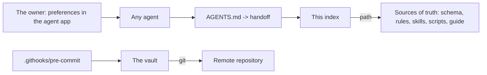

# Core Vault Architecture: the index

> **What it is:** the index of the vault's architecture. Every component is one entry that says what it is, where its truth lives, and what guards it. It copies no rule and no value: what you want is in the file it points at.

## Introduction and goals

**Reader:** any agent while it builds.

**How to use it:**
1. Start with `AGENTS.md`, then `AI-Agent/handoff.md`. Most "where" questions are answered by the handoff.
2. Open this index when the handoff is not enough: "what guards this?" and "what exists?". Read only the "Building blocks" section.
3. When two sources conflict, the higher wins: the owner's preferences, then the schema and the scripts, then [[rules]], then the binding guide sections, then this index. The index is a reference; it does not command.

**Goals, by priority:**

| # | Goal |
|---|---|
| 1 | Every fact in one place |
| 2 | The owner arranges nothing by hand |
| 3 | Session cost goes down and retrieval stays precise |
| 4 | A new project enters the existing structure |
| 5 | Recovery, safety, and any agent can work |

## Context and scope

**In scope:** the vault's structure and every file that is a source of truth for something an agent needs in order to change the vault. **Out of scope:** the content of the notes themselves.

## Building blocks

### M01 — Entry gate
- **path:** `AGENTS.md`
- **enforced_by:** prose

### M02 — Handoff (invariants and where everything lives)
- **path:** `AI-Agent/handoff.md`
- **enforced_by:** prose

### M03 — Rules registry
- **path:** `AI-Agent/rules.md`
- **enforced_by:** audit

### M04 — Frontmatter schema
- **path:** `AI-Agent/schema/frontmatter.yaml`
- **enforced_by:** audit

### M05 — Commit gate (the audit ratchet)
- **path:** `AI-Agent/scripts/audit.py`
- **enforced_by:** hook

### M06 — Pre-commit hook
- **path:** `.githooks/pre-commit`
- **enforced_by:** hook

### M07 — Current state
- **path:** `AI-Agent/scripts/state.py`
- **enforced_by:** script

### M08 — Skills
- **path:** `AI-Agent/skills/README.md`
- **enforced_by:** audit

### M09 — Traps registry
- **path:** `AI-Agent/traps/TR-0001.md`
- **enforced_by:** audit

### M10 — Permanent layer (the always-loaded context)
- **path:** `AI-Agent/permanent-layer.md`
- **enforced_by:** script

### M11 — Decision ledger
- **path:** `AI-Agent/schema/decision_ledger.py`
- **enforced_by:** audit

### M12 — Consumer map (live counters)
- **path:** `AI-Agent/schema/consumer-map.yaml`
- **enforced_by:** audit

### M13 — Release profile
- **path:** `AI-Agent/config/release_profile.yaml`
- **enforced_by:** audit

### M14 — Live architecture document
- **path:** `03-Resources/Live-Agent-Architecture.md`
- **enforced_by:** audit

### M15 — Templates
- **path:** `Templates/Project.md`
- **enforced_by:** prose
